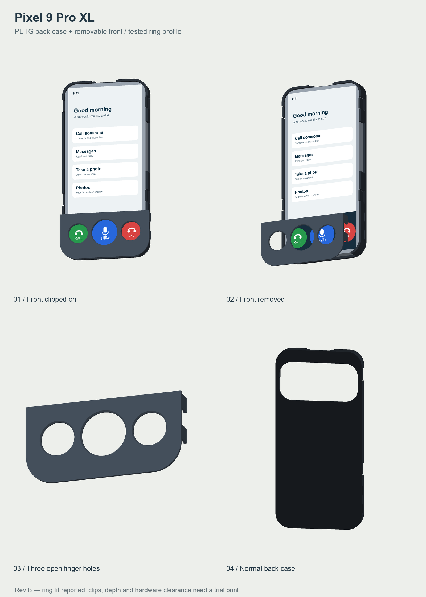

# Pixel 9 Pro XL case and removable keyguard

Revision B, PETG prototype, 21 October 2026. Two printed parts: a normal back
case and a removable front that clips into it. The front has three open holes
for touching the screen; the phone interface must position its controls below
them. No electronics or physical button caps are included.



## Files and print order

1. Start with [the three small clip tests](Rev-B-PETG/00_PRINT_FIRST_Clips_PETG.3mf).
   Check the front's socket and clip together, then the separate phone-retaining
   finger. These mechanisms have not yet been physically validated.
2. Print [the back case](Rev-B-PETG/stl/01_back_case_PETG.stl). Check its full-depth
   fit, retention, camera opening, buttons, microphones and connector access.
3. Print [the removable keyguard](Rev-B-PETG/stl/02_removable_keyguard_PETG.stl).
   Its four clips engage the case's lower side pockets.

Use PETG at **100% scale**, starting with 0.20 mm layers, a 0.4 mm nozzle,
3 walls and 20% infill. The supplied parts are oriented on the print bed.
Use the actual printer and filament profiles and inspect overhangs in the slicer.
These are starting settings; the files have not been validated by slicing in
Bambu Studio. The standard 3MF files contain geometry only, with no G-code.

- [Full print instructions and fit limits](Rev-B-PETG/README.txt)
- [Both main parts on one plate](Rev-B-PETG/Pixel_9_Pro_XL_Rev_B_PETG_Parts.3mf)
- [Editable STEP assembly](Rev-B-PETG/step/Pixel_9_Pro_XL_two_part_assembly.step)
- [Offline interactive 3D preview](Rev-B-PETG/preview/Open_3D_Preview.html)
  — download and open locally; GitHub displays the HTML source.
- [CadQuery source](Rev-B-PETG/source/) and [dimensions](Rev-B-PETG/parameters.json)
- [Verification report](Rev-B-PETG/verification.json) and
  [SHA-256 checksums](Rev-B-PETG/SHA256SUMS.txt)

## Fit evidence

The owner printed [this exact perimeter gauge](fit-test/Perimeter_R11.3_C0.30_PETG_FIT_TEST_ONLY.stl)
and reported that it fits the bare phone without forcing it. Revision B uses
the same 77.2 × 163.4 mm cavity outline, with an 11.6 mm modeled inner corner
radius and 0.30 mm clearance per side. This is qualitative evidence for the
outline, not a measurement of the phone's actual corner radius or depth.

The nominal body is 162.8 × 76.6 × 8.5 mm, from
[Google's specifications](https://support.google.com/pixelphone/answer/7158570?hl=en).
Camera and hardware windows remain provisional. Full case fit, screen protector
clearance, clip force, fatigue and protective performance need physical checks.
The CAD checks confirm valid solids and closed meshes, STEP re-import, nominal
assembly clearance and 3MF placement; they do not establish physical fit.

The screen graphics in the previews illustrate alignment only. The front covers
the lower 39 mm of the phone except for its 18 / 24 / 18 mm holes, centered
at X = −25 / 0 / +25 mm and 20 mm from the phone bottom. A real Android
interface must be aligned to the measured screen position. The [Android launcher](../../dumpphone/README.md#pixel-9-pro-xl-keyguard-alignment)
now derives its dock geometry from these parameters, using the provisional centered
display reference; physical alignment still needs checking on the phone. The front can
obstruct normal gesture navigation and can be removed when needed.

## Rebuild

From this folder, using Python 3.11 with the dependencies in
`Rev-B-PETG/source/requirements.txt`:

```sh
python3 -m venv .venv
.venv/bin/python -m pip install -r Rev-B-PETG/source/requirements.txt
.venv/bin/python Rev-B-PETG/source/build.py
.venv/bin/python Rev-B-PETG/source/check_exports.py
.venv/bin/python Rev-B-PETG/source/presentation.py
.venv/bin/python Rev-B-PETG/source/render_cpu.py
.venv/bin/python Rev-B-PETG/source/package.py
```

The last command refreshes the 3MF files, checksums and verification report and
creates a ZIP beside `Rev-B-PETG/`. Three.js r160 is bundled for offline viewing;
its [MIT license](Rev-B-PETG/preview/THREE-LICENSE.txt) is included.
